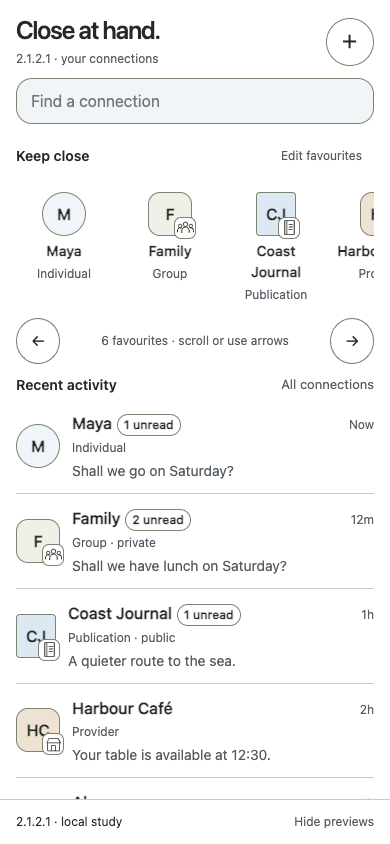
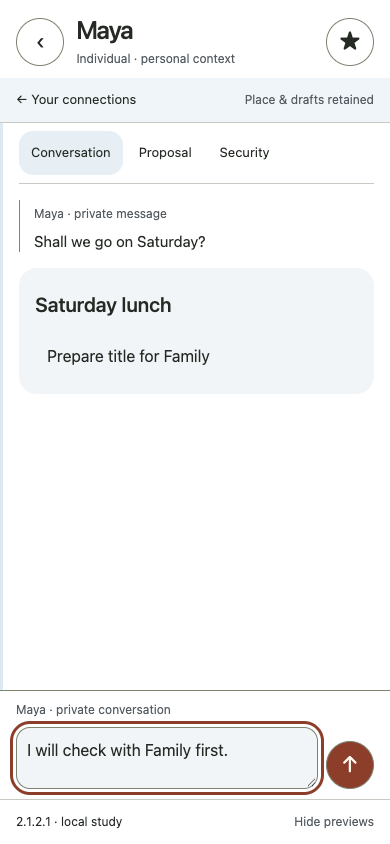
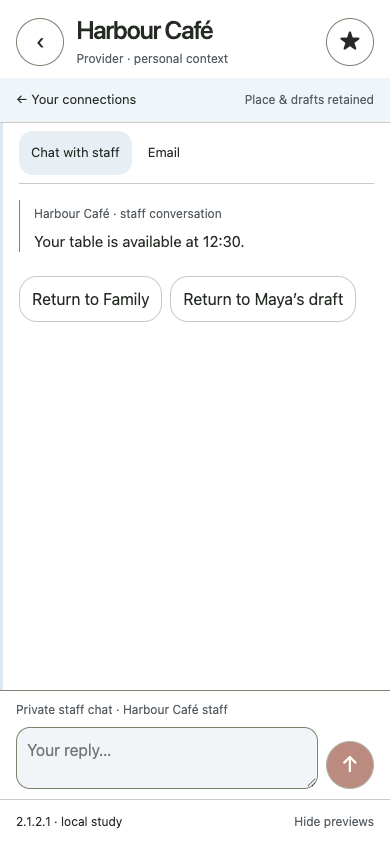

# SimpleX Chat — mobile design study

Selected interface views from an independent design exploration by **AustinWerner-KAI and credited contributors**.

This public gallery shows historical V2.1.2.1 captures from 4 October 2026. The working project’s latest recorded full-app candidate is V2.1.2.3; these screenshots are not captures of that later version. All people, messages and businesses shown are fictional. This is a design study, not a production app or an official SimpleX release.

## Selected screens

| Home | Conversation | Provider |
| --- | --- | --- |
|  |  |  |

## About this gallery

The public collection contains selected screenshots and this introduction. Research, theory, architecture, implementation and working history are maintained separately with restricted access.

For collaboration enquiries, visit [AustinWerner-KAI on GitHub](https://github.com/AustinWerner-KAI).

## Image attribution and reuse

The three screenshots were previously published as original design material under **Creative Commons Attribution 4.0 International**, by AustinWerner-KAI and credited contributors. That licence continues to apply to these images. Credit “From anatomy to interface — the future of mobile design for simplex.chat, initiated by AustinWerner-KAI and community contributors”, link to [CC BY 4.0](https://creativecommons.org/licenses/by/4.0/), and indicate changes.

Source captures: `studies/v2121-captures/home.png`, `conversation.png` and `provider.png`, published 4 October 2026. This gallery preserves those images unchanged. SimpleX names and trademarks retain their respective rights; no endorsement is implied.
